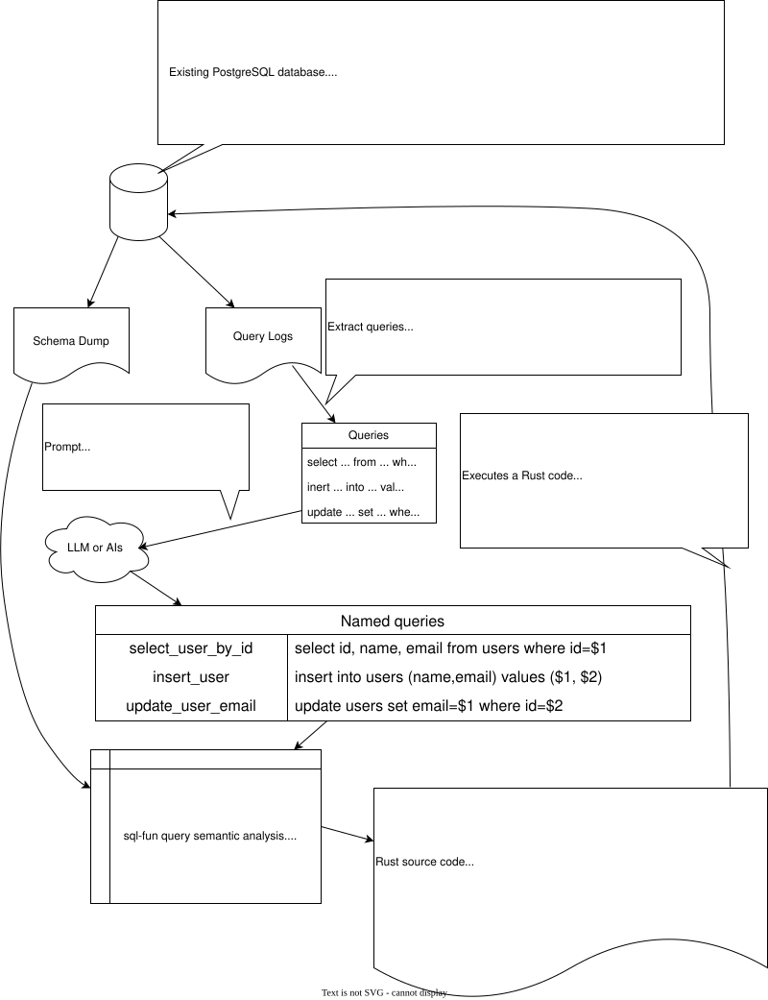

# Legacy Migration from Query Log

*This is a planning document outlining a potential future feature of `sql-fun`.  
It has not been implemented, and no timeline or commitment has been established.*

Modern databases often support query logging, which records a large number of **raw SQL queries** executed by applications.

By extracting these queries from the logs, we can analyze and reuse them.

Thanks to recent advancements in **LLMs and AI**, it's now feasible to automatically generate meaningful names for these anonymous queries — effectively turning them into **"named queries"**.

With `sql-fun`’s semantic query analyzer, we can infer:

- Binding parameter names and types  
- Result set column names and types

Combining this analysis with code templates, we can generate Rust code that:

- **Executes the exact same SQL queries** as those captured in the logs  
- Provides type safety and compile-time validation  
- Requires no ORM or runtime SQL parsing

This enables precise, safe migration from legacy applications — even when the original source code is unavailable.

> 🔧 This feature is not yet implemented.  
> We're currently exploring feasibility and potential use cases.  
> Community interest or sponsorship may influence its development priority.
